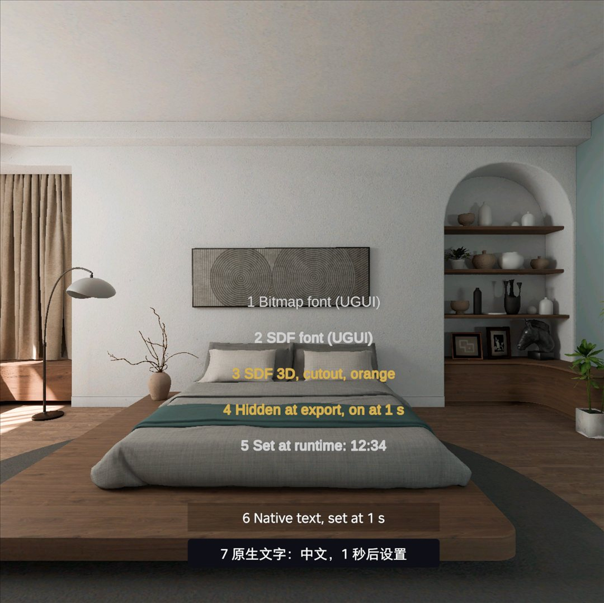
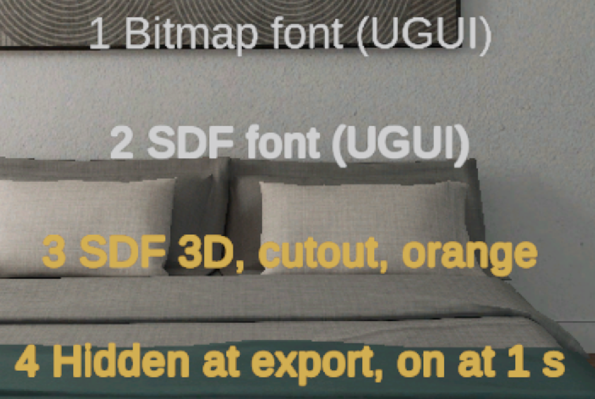
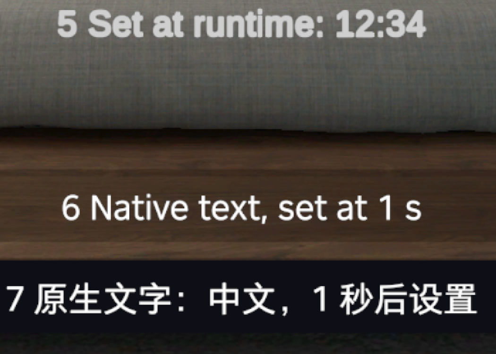

# PICO Spatial text repro

A minimal Unity project showing that **TextMeshPro text can't be made sharp in PICO Spatial mode**, alongside PICO's own `SpatialAdapterNativeText`, which can.

The question for PICO: **what is the recommended way to show sharp text that changes at runtime (names, counts, localized strings) in a Unity app in PICO Spatial mode?** Is `SpatialAdapterNativeText` it?



## Setup

| | |
|---|---|
| Unity | 6000.0.59f2, URP, Vulkan, IL2CPP, ARM64 |
| PICO Unity SDK | `com.bytedance.pico.xr` 6.1.1 |
| Spatial Adapter | `com.bytedance.pico.spatialadapter` 6.1.0, Full Space (Unconstrained spatial camera) |
| Exporter | PICO's fork of UnityGLTF (`com.plattar.unitygltf`) |
| Tested on | PICO emulator 6.1.0 |

## The issue

On Meta and other OpenXR targets, TMP text is crisp because TMP's SDF shader runs there. In PICO Spatial mode the scene is exported to glTF and drawn by the device, and every TMP setup we tried comes out soft:

1. **Bitmap TMP fonts** (`SMOOTH_HINTED`, static atlas) render, but thin and soft, with jagged, wavy edges when magnified.
2. **TMP SDF fonts on a world-space Canvas** (`TextMeshProUGUI`) render as a grey haze. UnityGLTF's `CanvasRendererExporter` exports every canvas graphic with `alphaMode: BLEND`, so the distance field is blended instead of thresholded.
3. **3D `TextMeshPro` with an SDF atlas**, using a copy of TMP's Distance Field shader tagged `RenderType=TransparentCutout`, exports as `alphaMode: MASK` (cutoff 0.5). The glyphs still come out swollen, and the face colour is muted.
4. **Memory:** every text object gets its own copy of the font atlas in the exported scene. In this repro, the four texts that share `LiberationSans Made SDF` produce four identical copies of its atlas in `TextMin.unity.glb`. With ~90 texts in our real app this adds up, so we keep atlases small, which makes the text even softer.

Our current workaround is to pre-render fixed labels into textures at build time. It doesn't work for text that changes at runtime.

## What the repro shows

The scene has one row per issue, all 40 mm tall, 1 m in front of you. Rows 4–7 change 1 s after launch.





| Row | What it is | Result on the emulator |
|---|---|---|
| 1 | TMP bitmap font, Canvas (`TextMeshProUGUI`) | Thin and soft |
| 2 | TMP SDF font, Canvas, exported as `BLEND` | Swollen glyphs with soft grey edges |
| 3 | 3D `TextMeshPro`, SDF, cutout shader (`MASK`), orange | Swollen glyphs, muted colour |
| 4 | Same as row 3, inactive at export, switched on at 1 s | Shows, same quality as row 3 |
| 5 | TMP SDF font, Canvas, string changed at 1 s | Updates, same haze as row 2 |
| 6 | `SpatialAdapterNativeText`, string changed at 1 s | **Sharp**, updates correctly |
| 7 | `SpatialAdapterNativeText`, English at export, Chinese at 1 s | **Sharp**, Chinese renders correctly |

Row 6's background panel is translucent black. Row 7's is opaque, with rounded corners.

## Findings and open questions

`SpatialAdapterNativeText` (in the Spatial Adapter package) is drawn by the device itself, with no font atlas. It's the only option we found that is sharp, changes at runtime and handles Chinese. Before we adopt it, we'd like PICO to confirm:

- **Is it the recommended approach**, and is it supported going forward? We found it in the package, not in the documentation.
- **What unit is `textSize` in?** The component converts with 1 pt = 0.352806 mm, which would make a 40 mm line 113 pt. On the device 113 pt draws about 3× too large; **38 pt** matches the 40 mm TMP rows.
- **Can it do more?** It exposes only text, size, colour, horizontal alignment and a background panel. There's no font choice, weight, outline, rich text or wrapping control, and it doesn't take part in Canvas layout.
- **If TMP is meant to work**, how do we get the device's SDF material to apply to Canvas text exported as `BLEND`, and should texts that share a font share one atlas in the export?

Not yet checked on a physical headset.

## Build and run

Close the Unity Editor first. `build.ps1` runs Unity in batch mode.

```powershell
.\build.ps1 -Setup     # first time: PICO Spatial project setup + TMP Essential Resources
.\build.ps1 -Install   # build Build/TextMin.apk, install it on the connected device and launch it
```

The scene is generated by [`Assets/Editor/TextMin.cs`](Assets/Editor/TextMin.cs) (`TextMin.Scene`). [`Assets/Scripts/SetTextAtStart.cs`](Assets/Scripts/SetTextAtStart.cs) makes the 1-second changes.
